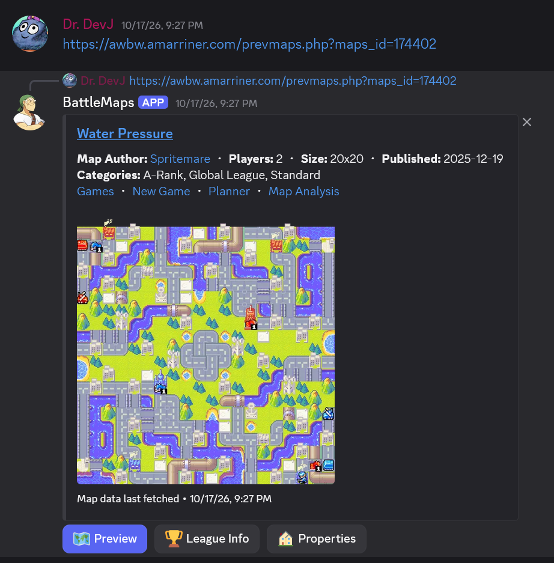

# BattleMaps Bot

A Discord bot for previewing Advance Wars By Web (AWBW) maps.



## What it does

BattleMaps Bot brings AWBW maps into Discord. Paste a map link or run `/map <awbw_id>` and it replies with a rendered preview, property counts, and the map's predeployed units. It can also watch chat and preview map links as they appear.

Server owners get a small set of maintenance commands for reloading, syncing, and refreshing map data.

## Community code archive

Scripts, snippets, and project links shared by the AWBW community in the "Community Development" thread are indexed in [community-code/README.md](community-code/README.md).

## Setup

1.  Install dependencies:
    ```bash
    uv sync
    ```

2.  Create a `.env` file for your Discord token:
    ```
    DISCORD_TOKEN=your_token_here
    ```

3.  Run the bot:
    ```bash
    uv run src/main.py
    ```

## Permissions & Intents

### Discord Developer Portal
**Crucial**: You must enable **Message Content Intent** for the bot to detect map links.
1. Go to the [Discord Developer Portal](https://discord.com/developers/applications/).
2. Select your application -> **Bot**.
3. Scroll down to **Privileged Gateway Intents**.
4. Toggle **MESSAGE CONTENT INTENT** to **ON**.
5. Save changes.

### Server Permissions
The bot requires the following permissions in the server/channel to function:
*   **View Channels**
*   **Send Messages**
*   **Embed Links**
*   **Attach Files**

If the bot doesn't respond to links, check that it has both **View Channels** and **Send Messages** permissions in the channel.
